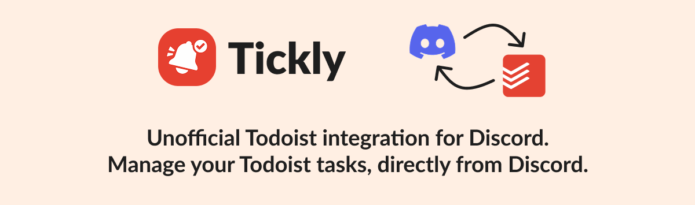
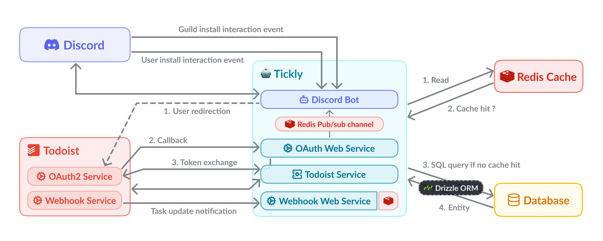

## 📋 [Overview](https://antoinemcx.fr/projects/tickly)

The bot is available in several languages: **English**, **French**, **German**, **Polish**, and **Spanish**.  
It is in early development so feel free to join the [discord server](https://antoinemcx.fr/discord) to follow the development progress.

### Features
* 📝 Create Todoist tasks via [command or right-clicking a message](./docs/en-US/getting-started.md#adding-your-first-task)
* 🔄 Automatically sync your Todoist tasks
* 📊 View your upcoming and overdue tasks with `/todoist upcoming`
* 🧰 [**SOON**] Create custom in-bot filters for task display (for example by project, due date, etc.)
* ⏰ [**SOON**] Send reminders at due date, daily, or reminders after a task stays incomplete for a defined duration

### How to use the bot
Tickly can be installed in two ways:
- [**Guild install:**](https://discord.com/oauth2/authorize?client_id=1483931102514249830&permissions=274878286848&integration_type=0&scope=bot) use Tickly inside a specific server.
- [**User install (recommended):**](https://discord.com/oauth2/authorize?client_id=1483931102514249830) use Tickly from anywhere in Discord, including DMs and servers.

After it is installed, you can interact with the bot by using:
- [**Slash commands**](https://discord.com/blog/welcome-to-the-new-era-of-discord-apps): type `/` in any text channel or DM and select a command.
- [**Message context menu**](https://discord.com/blog/welcome-to-the-new-era-of-discord-apps): right-click on any message and select a command from the "Apps" section.

> **New to Tickly?**  
> Follow the instructions in [docs/en-US/getting-started.md](./docs/en-US/getting-started.md), or the one in your language, to install the bot, log into Todoist and start interacting with it.

<br><br>

## 🏗️ Architecture
The project is structured in different services that communicate with the Discord and Todoist APIs.  
Redis is mainly used for caching and storing user sessions, while MariaDB is used for persistent storage.

The project architecure is as follows:  
[](./docs/architecture.png)

<br>

## 🤝 Contributing
### User feedback
If you find any errors or have any suggestions that could improve your task management workflow, feel free to open an issue on the [GitHub repository](https://github.com/antoinemcx/tickly-discord-bot/issues) with the `bug` or `enhancement` label.  
You can also join the support [discord server](https://antoinemcx.fr/discord) to share your feedback and suggestions with the community.

### Track upcoming features
You can track upcoming features and development progress on the [project board](https://github.com/users/antoinemcx/projects/3/views/1).  
Latest updates are also announced on the [support Discord server](https://antoinemcx.fr/discord).

### Developer contribution
Contributions to the project are very welcome.  
Refer to the [CONTRIBUTING.md](./.github/CONTRIBUTING.md) file for detailed contribution guidelines and workflow.

<br>

## 🛠️ Getting Started

### Start the app
#### With Docker (recommended)
1. Copy `.env.example` to a new `.env` file and fill in all required values (see [Encryption Key](./docs/configuration.md#encryption-key) for generating the `TOKEN_ENCRYPTION_KEY`).  
`DB_HOST` must be set to `tickly-db` to work with the Docker setup.

2. Copy `config.example.json` to a `config.json` file and replace with your own values (see [Configuration Reference](./docs/configuration.md)).

3. Build and start all services
   <details>
     <summary>With <a href="https://traefik.io/">Traefik</a> reverse proxy</summary>
     
     ```sh
     docker compose up -d --build
     ```
      
     This starts:
     - **tickly-bot**: the Discord bot and OAuth web service (exposed via [Traefik](https://traefik.io/) reverse proxy)
     - **tickly-db**: a MariaDB instance with persistent storage (migrations are run automatically)

     ‎   
     > ⚠️ For the OAuth callback service, [Traefik](https://traefik.io/) handles TLS termination with a Cloudflare certificate resolver.  
     > Make sure the external `traefik-proxy` Docker network and your Traefik instance are already running before starting Tickly.
   </details>

   <details>
     <summary>Without reverse proxy</summary>
        
     ```sh
     docker compose -f docker-compose.local.yml up -d --build
     ```
      
     This starts:
     - **tickly-bot**: the Discord bot and OAuth web service (on port `3999` or your configured port)
     - **tickly-db**: a MariaDB instance with persistent storage (migrations are run automatically)
   </details>

#### Without Docker
1. **Prerequisites**: Node.js (v22+) and a running MariaDB instance.

2. Copy `.env.example` to `.env` and fill in the values (see [Encryption Key](./docs/configuration.md#encryption-key) for generating the `TOKEN_ENCRYPTION_KEY`).  
`DB_HOST` will be `localhost` if the database is running locally.

3. Copy `config.example.json` to `config.json` and replace with your own values (see [Configuration Reference](./docs/configuration.md)).

4. Install dependencies and build:
   ```sh
   npm install
   npm run build
   ```

5. Run database migrations on the first run:
   ```sh
   npm run db:migrate
   ```

6. Start the bot:
   ```sh
   npm run start:nobuild
   ```

This starts the bot and the OAuth web service (default port `3999`) together.

### Development

Other npm scripts are available for development purposes:
| Command | Description |
|---------|-------------|
| `npm run start` | Clean, build, and start the bot |
| `npm test` | Run the test suite |
| `npm run lint` | Lint the source files |
| `npm run lint:fix` | Auto-fix lint issues |
| `npm run db:generate` | Database changes must be reflected in `src/database/schema`.<br>Then, a migration script can be generated with this command. |
| `npm run db:migrate` | Apply pending database migrations scripts |

<br>

## ⭐ Support my work
If you like the project, feel free to put a ⭐ !  
You can also join my [discord server](https://antoinemcx.fr/discord) if you want to have a word or two or if you have any question about the project.

## 📄 License
Tickly is licensed under the GPL-3.0 License. See the [LICENSE](./LICENSE) file for more details.  
This means that you are free to use and modify the software, but any derivative work must also be licensed under the same GPL-3.0 License.
