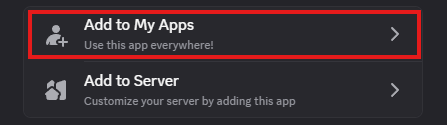
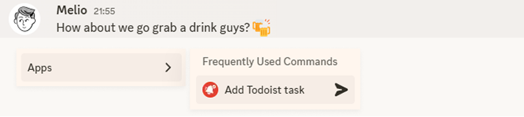
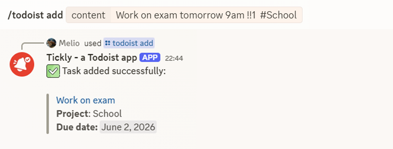

# Getting started with Tickly
## Installation
Tickly can be installed in two ways:
- [**Guild install:**](https://discord.com/oauth2/authorize?client_id=1483931102514249830) use Tickly inside a specific server.
- [**User install (recommended):**](https://discord.com/oauth2/authorize?client_id=1483931102514249830) use Tickly from anywhere in Discord, including DMs and servers.

We recommand installing Tickly **on your user account**, as a user install, for the best experience.  
It allows you to use the bot from anywhere in Discord : in DMs or in any server, even if they didn't add it.  
Some commands may be available only with a user installation.

> Nevertheless, please note that some servers can disallow user-installed apps (called "external apps" in Discord permissions).  
> The bot would thus not work in those servers and you might need the server to install it as a guild install instead.

## First steps
If you are new to the bot, follow these simple steps:
1. Install Tickly on your user account or on your server.
2. Open any chat where Tickly is available, type `/`, and run `/todoist login`.
3. You will be redirected to Todoist OAuth2 login.  
After you approve access, Tickly encrypts and stores your Todoist access token in a session for future interactions.
4. Back in Discord, run `/help` to see the commands list and a start guide.

## Interacting with the bot
After it is installed, you can interact with the bot by using:
- [**Slash commands**](https://discord.com/blog/welcome-to-the-new-era-of-discord-apps): type `/` in any text channel or DM and select a command.
- [**Message context menu**](https://discord.com/blog/welcome-to-the-new-era-of-discord-apps): right-click on any message and select a command from the "Apps" section.

## Adding your first task
To add a task to Todoist, you have three options:
1. Use the `/todoist add` slash command and fill in the form.
2. Use the "Add to Todoist" message context menu command on any message.  
   This will pre-fill the form with the message content.

   
3. Use the parameter `content` of the `/todoist add` command to use natural language input.  
   For example, you can type `/todoist add content:Buy milk tomorrow at 5pm !!2 #MyProject`. See more [here](https://www.todoist.com/fr/help/articles/use-task-quick-add-in-todoist-va4Lhpzz#h_01J1DEY59AGACAT8JW998EPH74).

   